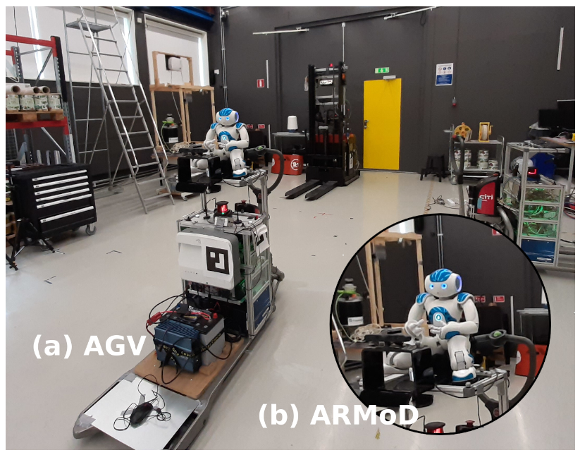
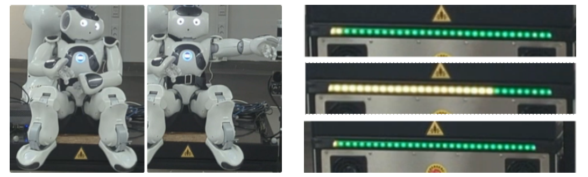
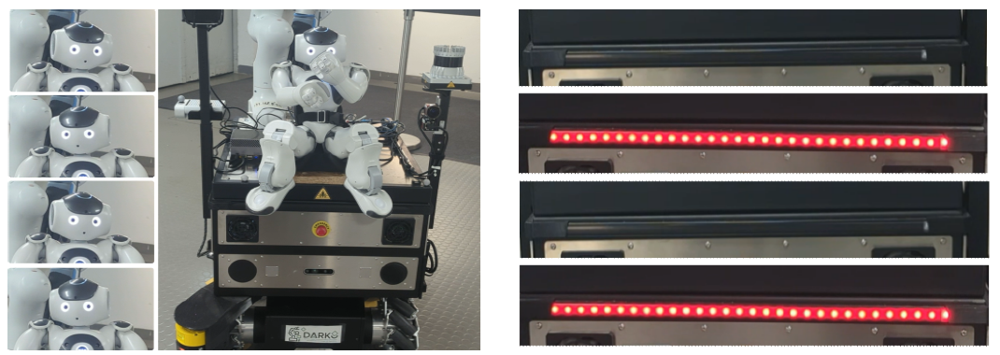

# Introduction to the ARMoD Concept

The Anthropomorphic Robotic Mock Driver (ARMoD) is a small robotic character that is mounted
on top of a mobile robot to communicate what the robot is going to do. Through gaze, head
orientation, gestures and speech, it tells the people around the robot where it is heading
and what state it is in, in a way that is quick and intuitive to understand. This page
explains where the concept comes from and what the new ARMoD aims to be.

## Motivation

Thanks to the recent advances in perception, localization and mapping, mobile robots are
increasingly working in environments shared with humans, such as factories, warehouses,
laboratories, hospitals and hospitality. Both Automated Guided Vehicles (AGVs), which are
usually limited to predefined paths, and Autonomous Mobile Robots (AMRs), which navigate
freely, have to move safely around the people they share the space with.

In both cases, the movement of the robot introduces ambiguity about its intended trajectory
and upcoming actions. This does not only bring safety risks, but also hesitation,
coordination friction and a reduced efficiency in the collaboration between humans and
robots, which in turn reduces the acceptance of robots in shared spaces.

The current standards for robot navigation signalling mostly rely on unimodal cues, such
as flashing Light-Emitting Diodes (LEDs), acoustic beepers or floor projections. However,
these low-expressivity signals are often hard to read and easy to misinterpret in complex,
real-world workspaces, while the use of multimodal cues has been shown to improve
Human-Robot Interaction (HRI). On the other hand, humans decode anthropomorphic non-verbal
cues, such as gaze or gestures, faster and with more trust, which makes the intent of the
robot both more legible and more predictable. The ARMoD is built on this idea.

## The Original ARMoD

The concept of the ARMoD was introduced within the EU DARKO project. In it, a SoftBank
Robotics NAO humanoid robot was mounted on a mobile platform to convey its navigation
intent and operational status through gaze, head orientation and gestures, as shown in
Figure 1. The studies carried out with this setup showed improvements in worker trust and
in the legibility of the interaction, that is, how easily people can read and anticipate
the intent of the robot.

{: .center width=500 }

*Figure 1: The ARMoD setup by Schreiter et al., featuring a NAO humanoid robot (b)
mounted on a mobile platform (a) to convey navigation intent.*
{: .center}

A similar concept had already been explored before by Severinson-Eklundh et al. with
CERO, a small and minimalist anthropomorphic character mounted on top of a service robot
in an office. CERO could move its arms in a running-like fashion and nod, which improved
how the intent of the service robot was communicated to the people around it. The users
also attributed personality traits to the robot, which supports the idea that human-like
features and gestures improve trust, likeability and task performance.

The later ARMoD studies by Schreiter et al. compared the anthropomorphic cues of the
NAO against an LED light strip, both for signalling a direction (Figure 2) and for
signalling an internal error state (Figure 3). Combining the gaze and pointing gestures of
the NAO with verbal communication substantially reduced the reaction times of the
participants and improved the legibility of the navigation intent.

{: .center width=650 }

*Figure 2: Spatial direction signalling in the ARMoD setup by Schreiter et al.,
comparing head orientation and arm pointing gestures (left) with a dynamic LED light strip
sweep (right).*
{: .center}

{: .center width=650 }

*Figure 3: Internal error state signalling in the ARMoD setup by Schreiter et al.,
comparing head motion and upper-body gestures (left) with a flashing red LED light strip
(right).*
{: .center}

## Limitations of the Original Setup

While the NAO was useful for the first proof-of-concept studies, relying on an
off-the-shelf humanoid robot is a significant barrier for wider research and industrial
use. Commercial humanoids are expensive, carry redundant parts for this application (such
as the bipedal legs) that add weight and bulk, and often run on proprietary software that
makes the integration with robotics middleware such as ROS 2 harder.

The same applies to most of the open-source humanoid and upper-body platforms available
today. Most of them are designed for full bipedal locomotion, which adds complexity, mass
and cost (often several thousand euros) that an ARMoD does not need. To date, no
open-source, cost-effective and modular intent communication module exists that combines a
reproducible physical design with an accessible software architecture.

## The New ARMoD

The aim of this project is to take the ARMoD concept from a proprietary humanoid robot to
an open, lightweight and platform-agnostic module, pushing it towards the Tech Ready
category defined by the EU Innovation Radar. The new ARMoD should be:

- **Open-source:** both the hardware and the software are open, so that the module can be
  reproduced by other research groups.
- **Cost-effective:** it only includes the parts needed to communicate intent, without the
  redundant components of a full humanoid, for a total cost below €1,000.
- **Modular and transferable:** it can be mounted on different mobile robots, regardless of
  their base, and integrated with them through ROS.

The total cost of the module is expected to stay below €1,000, and its size is around
50 cm. Its body is 3D-printed, which keeps it cheap and easy to reproduce. Each arm has four
joints and the head has two, for pan and tilt, so the robot is moved by ten servos in total.

## Appearance

The external appearance of the robot is one of the first things to consider when aiming to
increase user trust. However, a more human-like robot is not always a more trusted one. A
robot that is almost, but not fully, human-like can feel unsettling instead of familiar, an
effect known as the "uncanny valley".

For this reason, the ARMoD takes a compact form factor with a visibly robotic appearance
and only a selected set of human-like features. This supports user comfort, approachability
and likeability, while keeping the complexity of the design low.

## Communication Modalities

The communication capabilities of the ARMoD are another key part of the concept. As seen
with the original ARMoD, simple status messages can be conveyed with low-expressivity
signals, but more complex messages, such as turning intentions or requests for assistance,
benefit from combining several cues. While it would be ideal to have every possible
communication modality available, cost and development time limit how many of them can be
implemented. The ARMoD therefore focuses on the following ones:

- **Gestures:** human-like upper-body gestures with two articulated arms, used both to point
  in a direction and to express internal states, such as crossed arms or raised hands for
  faults and emergency stops.
- **Head orientation:** a clear, forward-facing orientation cue that is decoupled from the
  movement of the mobile base. This is especially useful for bases without a visible front,
  such as cylindrical robots, or for omnidirectional AMRs whose chassis does not point in
  the direction of travel.
- **Gaze:** one of the defining features of the ARMoD, used to show where the robot is
  directing its attention and to establish mutual awareness with the people nearby.
- **Audio and speech:** auditory signals for immediate warnings and synthesized speech to
  explain the intent and the status of the robot. Speech is especially useful when there is
  no direct line of sight between the person and the robot.
- **Status lights:** LEDs that give an immediate, omnidirectional indication of the
  operational mode, fault conditions and safety states.

Other modalities, such as floor projection and touch, are not part of the concept.
Projection is not practical due to the position of the ARMoD, far from the ground, and
touch is not needed, as the robot is not intended to be in physical contact with the people
around it.
