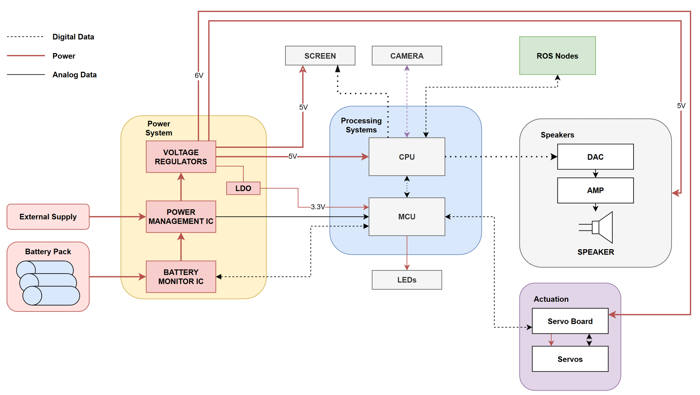

# Electrical Architecture

The architecture of the ARMoD is comprised by the different subsystems and components, as
well as the electrical lines that provide power and communication between them. At this
stage the architecture is kept component agnostic: it defines what each block has to do
and how the blocks are connected, but not which specific part will be used for each one.
This allows the overall structure to be fixed while the component selection is still
ongoing.

The main characteristic of the system is the use of two processing units, a Central
Processing Unit (CPU) and a Microcontroller Unit (MCU). The CPU deals with the high-level
software, while the MCU takes care of the low-level hardware, such as the servos, the
LEDs and the power monitoring. This approach adds a link to be careful of between both
units, but it keeps the hardware handling separate from the high-level software.

A block diagram of the ARMoD architecture is provided up next.

{: .center }

*Figure 1: ARMoD System Agnostic Architecture Block Diagram*
{: .center}

Three types of line are used in the diagram: red solid lines for power, black dashed lines
for digital data and black solid lines for analog data. While the diagram may appear
complicated at first sight, it should be easy to follow once each subsystem (SS) is
properly understood. To get some insight into the latter, a simple explanation of each
SS is given below.

## Power System

The Power System is in charge of managing the power distribution and regulation of the
robot. Energy can get into the system from two sources: the battery pack or an external
supply.

The battery pack is a lithium-ion pack in a three-series, one-parallel (3S1P) configuration,
with a nominal voltage of around 11.1 V. During development a 3000 mAh pack is used. The
runtime can easily be extended later, either with higher capacity cells or by hot-swapping
the battery packs.

The external supply provides 24 V. In the current design it comes from a wall outlet
through an adapter, but with a suitable adapter it could also be taken from the main robot.

The battery pack is connected first to the battery monitor Integrated Circuit (IC), which
keeps track of the battery state and reports it to the MCU through a two-way digital link.
From there, both the battery and the external supply arrive at the Power Management IC
(PMIC). The PMIC decides which of the two sources feeds the robot, and also provides an
analog signal to the MCU.

Power is distributed to the rest of the system after passing through the voltage
regulators, a block of buck converters. They provide a 5 V line to the CPU, the screen, the
DAC and the AMP, and a separate 6 V line to the servo board. Note that
the MCU works at a lower voltage, so a Low-Dropout regulator (LDO) is placed after the
voltage regulators to provide it with 3.3 V.

## Processing Systems

The Processing Systems are formed by the CPU and the MCU, which are connected to each other
through a two-way UART link. The data exchanged between them (movement requests from the
CPU, servo and power states from the MCU) is small, so a UART is fast enough while being the
simplest and most efficient option: both units have hardware UARTs, it only needs two data
lines, the transfers can run through Direct Memory Access (DMA) without loading either
processor, and, being full-duplex, either side can send data at any time without having to
be polled.

The CPU acts as the brain of the robot. It runs the high-level software and is connected to
the camera, the screen, the Robot Operating System (ROS) nodes and the MCU, as well as
sending the audio to the speakers.

The MCU, on the other hand, is in control of the hardware that needs a more direct
handling. It sends the commands to the servo board, reads the battery monitor IC and the
PMIC, and drives the Light-Emitting Diodes (LEDs) directly from its pins.

## Actuation

The Actuation subsystem is responsible for the movement of the robot. It is formed by the
servo board and the servos. The servo board receives the 6 V line directly from the voltage
regulators and the commands from the MCU, and passes both of them on to the servos.

The MCU is connected to the servo board through a two-way Universal Asynchronous
Receiver-Transmitter (UART) interface, which uses separate transmit and receive lines. The
MCU sends the commands to the servos through it, and the servos report their state back. The
servo board has two tasks. On one hand, it distributes the power coming from the voltage
regulators to the servos. On the other hand, it converts the full-duplex UART coming from
the MCU into the half-duplex single-wire Transistor-Transistor Logic (TTL) serial bus used
by the servos, where transmit and receive share the same line.

The servos are daisy-chained on this bus: each servo is connected to the next one, so the
power and the data reach all of them through the same chain of cables. Each servo is
addressed individually on the bus by its own ID.

The sizing of the servos is explained in
[Servo Torque Sizing](../../02-subsystems/01-mechanical/01-servo-torque-sizing.md).

## Speakers

The Speakers subsystem provides the robot with sound. The audio is generated at the CPU and
sent as digital data to a Digital-to-Analog Converter (DAC). From the DAC onwards the signal
is analog: it is amplified by the amplifier (AMP) and finally reproduced by the speaker.
Both the DAC and the AMP are powered from the 5 V line of the voltage regulators.

## ROS Nodes

The ROS nodes exchange information with the CPU in both directions. The link with the main
robot, where the rest of the ROS nodes run, is wireless, over Wi-Fi.

## Peripherals

Finally, a few peripherals are connected directly to the processing boards.

The screen is a 7-inch Liquid Crystal Display (LCD) with a resolution of 1024 × 600 pixels,
placed in the head of the robot. It receives its data from the CPU and its power from the
5 V line. The camera is also mounted in the head and has a two-way digital link with the
CPU. The LEDs, as mentioned before, are driven by the MCU.

What each of these blocks does within the robot is described in the
[Functional Architecture](02-functional-architecture.md).

## Interfaces

A summary of every connection in the diagram is given below:

| From | To | Interface |
|------|----|-----------|
| Battery pack | Battery monitor IC | Power, 11.1 V nominal (3S1P Li-ion) |
| Battery monitor IC | PMIC | Power |
| External supply | PMIC | Power, 24 V |
| PMIC | Voltage regulators | Power |
| Voltage regulators | CPU | Power, 5 V |
| Voltage regulators | Screen | Power, 5 V |
| Voltage regulators | Servo board | Power, 6 V |
| Voltage regulators | DAC | Power, 5 V |
| Voltage regulators | AMP | Power, 5 V |
| Voltage regulators | LDO | Power |
| LDO | MCU | Power, 3.3 V |
| Battery monitor IC | MCU | Digital, two-way |
| PMIC | MCU | Analog |
| MCU | CPU | Digital, two-way, UART |
| MCU | Servo board | Digital, two-way, UART |
| MCU | LEDs | Driven from MCU pins |
| Servo board | Servos | Power and digital (two-way), half-duplex single-wire TTL serial, daisy-chained |
| CPU | ROS nodes | Digital, two-way, Wi-Fi |
| CPU | Camera | Digital, two-way |
| CPU | Screen | Digital |
| CPU | DAC | Digital |
| DAC | AMP | Analog |
| AMP | Speaker | Analog |
