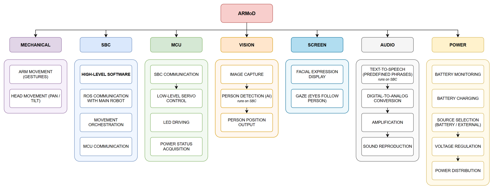

# Functional Architecture

While the [Electrical Architecture](01-architecture.md) defines the blocks of the ARMoD and
how they are connected, the functional architecture describes what the system has to do and
which of those blocks takes care of each function. As with the electrical architecture, it
is kept component agnostic.

The functions are split between the two processing units. The CPU carries out the
high-level functions of the robot: the facial expressions, the person tracking, the speech
and the communication with the rest of the system. The MCU carries out the low-level
functions that need a more direct handling of the hardware.

A diagram of the functional architecture, organised by subsystem, is provided up next.

{: .center }

*Figure 2: ARMoD Functional Architecture Diagram*
{: .center}

## Facial Expressions

The screen is dedicated to showing the facial expressions of the robot, which are driven by
the CPU. One of the most important of these, as shown by the original ARMoD, is the gaze
mechanism, that is, the robot's gaze, which is represented on the screen through the
robot's eyes. For now, the screen only shows the eyes.

## Person Tracking

For the eyes on the screen to follow the person in front of the robot, the robot has to know
where that person is. The camera, mounted in the head, captures the images, which are then
processed on the CPU by an Artificial Intelligence (AI) algorithm. The result is used both
to update the gaze of the eyes shown on the screen and to turn the head towards the person.

## Speech

The CPU runs the Text-to-Speech (TTS) of the robot from a set of predefined phrases, for now
only in English. The
generated audio is sent to the Speakers subsystem to be reproduced.

## Communication with the Main Robot

The CPU communicates with other ROS nodes, which is where the high-level behaviour of the
robot is run from. Through them, the ARMoD exchanges information with the main robot, such
as the internal states of the robot, its potential paths and the data acquired by other
relevant sensors.

## Movement

The movement of the robot is split between both processing units. At a high level, it is the
CPU that orchestrates which movements the robot performs, depending on the needs of the
robot on which the ARMoD is mounted and on its environment. The CPU then requests these
movements from the MCU.

The MCU coordinates the Actuation subsystem. It receives the orders from the CPU and takes
care of the low-level control of each servo, which is the one that finally carries out the
movement. In this way, the CPU decides what to move, while the MCU decides how each servo
has to move to achieve it. The movements carried out by the servos are those of the arms,
used for gestures, and the pan and tilt of the head.

## Low-Level Hardware Control

Apart from the movement, the MCU carries out the other functions closest to the hardware:
driving the LEDs and monitoring the battery and the power supply.

## Power

The Power subsystem selects whether the robot is fed from the battery or from the external
supply, charges the battery from the external supply, and regulates and distributes the
power to the rest of the robot. The state of the battery and of the supply is reported to
the MCU.

## Summary

| Function | Processing unit | Blocks involved |
|----------|-----------------|-----------------|
| Facial expressions and gaze | CPU | Screen |
| Person tracking | CPU | Camera, screen |
| Speech (TTS) | CPU | DAC, AMP, speaker |
| Communication with the main robot | CPU | ROS nodes |
| Movement orchestration | CPU | MCU |
| Low-level servo control | MCU | Servo board, servos |
| LED control | MCU | LEDs |
| Power monitoring | MCU | Battery monitor IC, PMIC |
| Battery charging and source selection | — | PMIC |
