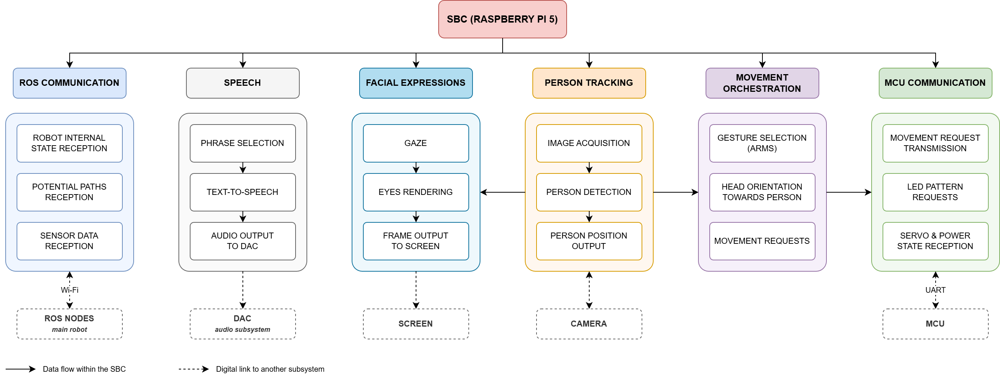

# Subsystem Description

## Introduction

The ARMoD requires a computing platform capable of orchestrating the motions and actions of the robot, as well as communicating with the mounted AMV/AMR. This is derived from the necessity to keep the system agnostic to the vehicle to which is mounted, leading to the the implementation of a processor with enough capacity to run small vision models (for gazing mechanisms), display visuals on a screen (to convey the gaze as well as any other information) and interfacing through ROS2.

Different commercially available products meet these functional requirements, but few do so in a cost and power budget efficient manner. In the following subsections the computing platform selection is discussed, along with its functional and physical architecture.

## Platform Selection

To choose the main processor of the robot, several existing humanoid and expressive robotic platforms were reviewed first to compare what hardware they use. Even though these robots differ in size and purpose, the available computing options mostly fall into three groups: standard PCs and mini-PCs, NVIDIA Jetson boards, and single-board computers (SBCs) like the Raspberry Pi. A list of reference platforms and their processors is shown in Table 1.

| Platform | Computing Unit |
|:---:|:---:|
| DARwIn-OP | Intel Atom 1.6 GHz |
| Asimov v1 | Raspberry Pi 5 |
| Berkeley Humanoid Lite | Intel N95 Mini PC |
| Fauna Sprout | NVIDIA Jetson AGX Orin |
| InMoov | Full Computer |
| pib | Raspberry Pi 5 (8 GB) |
| Poppy Project | Raspberry Pi 4 Model B |
| Reachy 2 | BEDROCK V3000 BASIC |
| Reachy Mini | Raspberry Pi Compute Module 4 |
| Robotis AI Sapiens | NVIDIA Jetson Orin NX (16 GB) |
| Roboto Origin | Orange Pi 5 Plus |
| SoftBank NAO | Intel Atom E3845 |
| ToddlerBot | NVIDIA Jetson Orin NX |
| YAREN | NVIDIA Jetson Nano |

*Table 1: Computing units used in similar humanoid and expressive robotic platforms.*

### PCs and Mini-PCs

Standard computers and x86 mini-PCs provide plenty of processing power and can run Linux and ROS2 out of the box without compatibility issues. However, using an external desktop or laptop (as done in stationary setups like InMoov) requires cables to an outside machine, which goes against keeping the ARMoD self-contained and independent of the mobile base. Using an onboard mini-PC or an industrial computer (such as in Berkeley Humanoid Lite or Reachy 2) solves this, but these units are still bulky, heavy, more expensive, and usually need active cooling. In addition, they generally require higher supply voltages (between 12 V and 19 V) and draw much more power under load, which complicates the battery and power design for an amount of computing power that the ARMoD does not actually need.

### NVIDIA Jetson Family

NVIDIA Jetson boards are very common in robotics whenever cameras and AI models are used, since they include a dedicated GPU. Still, none of the options in this line fit the project budget and requirements well. High-end modules like the Jetson Orin NX and AGX Orin (used in ToddlerBot, Robotis AI Sapiens, and Fauna Sprout) are meant for heavy deep learning and full-body control, so they are far too expensive and power-hungry for running small gaze models, especially considering the total budget of the robot. On the cheaper end, the older Jetson Nano (used in YAREN) has a reasonable price, but its hardware is outdated and NVIDIA no longer updates its official Ubuntu and JetPack versions, which makes running current ROS2 distributions difficult without extra workarounds like Docker containers. The newer Jetson Orin Nano fixes this software limitation, yet it is still much more expensive than a regular SBC, takes up more space with its carrier board, and consumes more power for a GPU that would barely be used.

### Raspberry Pi Family

ARM single-board computers, and especially the Raspberry Pi line (used in Poppy Project, Reachy Mini, Asimov v1, and pib), offer the best balance between price, power consumption, and ease of use for the ARMoD. Compared to other SBC brands like Orange Pi, Raspberry Pi boards are easier to source, have much better community and software support for Linux and ROS2, and include ready-to-use ports for the camera, the screen, and the UART link to the microcontroller. They also run directly from a 5 V line, which fits nicely with the rest of the electrical architecture and keeps power consumption low. Within this family, the Raspberry Pi 5 (8 GB) was chosen over the Raspberry Pi 4 Model B with the same 8 GB of RAM. For only an approximate €30 more, the Raspberry Pi 5 brings a noticeable jump in CPU speed, giving enough room to run the small vision models for gazing, update the screen, and handle wireless ROS2 communication at the same time.

## Functional Architecture

{: .center }
