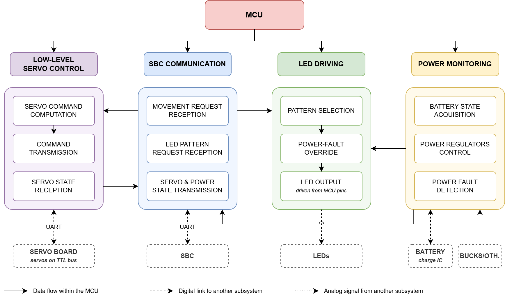

# Subsystem Description

## Introduction

While the Raspberry Pi 5 handles the high-level behaviour of the ARMoD, running a general-purpose Linux operating system makes it poorly suited for deterministic, pin-level hardware interaction. To keep real-time tasks separate from the vision, speech, and ROS2 pipelines, the processing architecture pairs the SBC with a dedicated Microcontroller Unit (MCU). The MCU acts as the low-level hardware controller of the robot: it translates high-level motion requests into serial commands for the ten joints, drives the status LEDs directly from its pins, and supervises the battery and power regulators.

Splitting the workload in this way simplifies software debugging and ensures that hardware safety tasks, such as power-fault signalling, remain active even if the high-level software is still booting or becomes unresponsive. In the following subsections, the selection of the microcontroller platform is discussed alongside its functional architecture.

## Platform Selection

To decide how to handle low-level control, the same reference humanoid and expressive robotic platforms reviewed for the SBC were examined to see how they interface with their actuators and onboard electronics. Depending on the complexity of the robot, existing designs generally follow one of three approaches: driving smart servos directly from the main computer through bus adapters without a dedicated MCU, using maker-oriented boards such as Arduino or Raspberry Pi Pico, or relying on 32-bit ARM Cortex-M microcontrollers from the STM32 family. A summary of the reference platforms is provided in Table 1, where entries marked with a dash interface their actuator buses directly from the main computing unit rather than through a separate sub-controller.

| Platform | Low-Level / Servo Control Unit |
|:---:|:---:|
| DARwIn-OP | STM32F103RE |
| Asimov v1 | Radxa CM5 |
| Berkeley Humanoid Lite | — |
| Fauna Sprout | — |
| InMoov | Microchip ATmega2560 |
| pib | Tinkerforge Servo Bricklet 2.0 |
| Poppy Project | — |
| Reachy 2 | — |
| Reachy Mini | — |
| Robotis AI Sapiens | — |
| Roboto Origin | STM32G431 |
| SoftBank NAO | ARM7TDMI / STM32 |
| ToddlerBot | — |
| YAREN | — |

*Table 1: Low-level and servo control units used in similar humanoid and expressive robotic platforms.*

### Direct SBC Control and Dedicated Adapters

Many platforms built around smart serial servos (such as Poppy Project, Reachy Mini, ToddlerBot, and YAREN) omit a separate microcontroller altogether and connect the servo bus straight to the main computer through a USB-to-serial adapter, such as the Robotis U2D2, or through dedicated peripheral modules like the Tinkerforge Servo Bricklet 2.0 used in pib. While this removes the need to write and maintain separate firmware for motor control, it falls short of the broader electrical needs of the ARMoD. Off-the-shelf USB servo adapters add cabling bulk inside a compact torso, especially when splitting the arms and head across separate buses, and still leave the Raspberry Pi without analog inputs or deterministic timing for driving LEDs, monitoring battery charge ICs, and managing voltage regulators independently of the Linux OS.

### Arduino Boards and Raspberry Pi Pico 2

Entry-level microcontroller boards are widely accessible and well supported, making them a natural starting point for prototyping. Classic 8-bit AVR boards like the ATmega2560 (used in InMoov) are bulky, operate at 5 V logic levels, and lack the clock speed and Direct Memory Access (DMA) support needed to service multiple high-speed serial links efficiently. Newer hybrid platforms such as the Arduino UNO Q integrate an STM32 microcontroller alongside a Linux processor on a single board, but coupling both units reduces modularity and limits hardware and software flexibility compared to pairing a standalone SBC with an independent MCU. Within modern standalone options, the Raspberry Pi Pico 2 (based on the RP2350) was closely considered due to its very low cost, compact footprint, and strong documentation. However, the RP2350 only includes two hardware UART peripherals, which is insufficient to maintain a dedicated UART link with the SBC while simultaneously driving up to three separate servo adapter chains (one for each arm and one for the head). Relying on its Programmable I/O (PIO) state machines to emulate extra UARTs introduces a risk of dropped bits at the high baud rates used by serial bus servos, which could compromise joint control.

### STM32 Family

32-bit ARM Cortex-M microcontrollers from STMicroelectronics are well established in robotics sub-controllers (such as in DARwIn-OP, SoftBank NAO, and Roboto Origin) because they combine deterministic real-time execution with rich peripheral sets and very low power consumption. Within this family, the STM32F446RE (an ARM Cortex-M4 running at up to 180 MHz) fits the ARMoD architecture particularly well. Operating from the 3.3 V LDO rail with a power draw below 0.3 W, it provides six hardware UART/USART interfaces with DMA support, alongside hardware timers, digital communication buses, and 12-bit analog-to-digital converters (ADCs). Having plenty of dedicated hardware UARTs allows the MCU to communicate with the Raspberry Pi 5 in full duplex while driving the three serial bus servo adapter boards independently. For initial development and prototyping, the NUCLEO-F446RE development board was selected for its low cost, wide availability, pin headers, and integrated ST-LINK debugger. In future iterations, once the circuit is validated, space and integration can be improved either by moving to a smaller Black Pill form-factor board or by placing the bare STM32 microcontroller directly onto a custom PCB.

## Functional Architecture

With the STM32F446RE selected as the low-level controller, its firmware responsibilities can be divided into four main functional blocks, as shown in Figure 1. In the diagram, solid arrows represent internal data flow within the MCU, dashed arrows represent digital links to other subsystems, and the dotted arrow represents analog signals coming from the power subsystem. Overall, the MCU acts as a real-time bridge that executes motion and lighting commands sent by the SBC while continuously monitoring the actuators and power electronics, overriding normal LED patterns locally if a power fault occurs.

{: .center }

*Figure 1: Functional architecture of the MCU (STM32F446RE).*
{: .center }

### Low-Level Servo Control

This block coordinates the Actuation subsystem so the SBC does not have to manage joint-level timing. Upon receiving high-level motion targets from the SBC Communication block, it computes the corresponding individual servo commands and transmits them over hardware UART links to the servo driver boards (up to three separate boards, covering the two arms and the head), which convert the full-duplex UART signals into the half-duplex single-wire TTL bus of the daisy-chained servos. In the opposite direction, it reads the feedback packets returned by the servos and forwards the collected joint states back to the SBC Communication block.

### SBC Communication

The SBC Communication block manages the full-duplex hardware UART interface between the STM32F446RE and the Raspberry Pi 5, using DMA transfers so data exchange does not block real-time control loops. On the incoming side, it receives movement requests and routes them internally to Low-Level Servo Control, as well as LED pattern requests destined for the LED Driving block. On the outgoing side, it provides the joint feedback from Low-Level Servo Control with the battery and supply telemetry from Power Monitoring, transmitting both back to the SBC.

### LED Driving

The LED Driving block controls the status lights that give an immediate visual indication of the ARMoD's operational mode and health. Under normal operation, it selects the lighting pattern requested by the SBC Communication block and drives the LEDs directly from the MCU pins. Between pattern selection and the physical output stage sits a power-fault override mechanism fed directly by the Power Monitoring block. If an abnormal supply or battery condition is detected, the MCU overrides the SBC's requested pattern to display a fault warning immediately.

### Power Monitoring

The Power Monitoring block supervises the electrical health of the ARMoD and manages its regulation stages. Through a two-way digital link with the battery charge and monitoring IC, it acquires the current battery state, charging status, and active power source. At the same time, it controls the enable lines of the power regulators. When a fault is identified, it triggers the override in the LED Driving block while also reporting the updated power state to the SBC Communication block.
