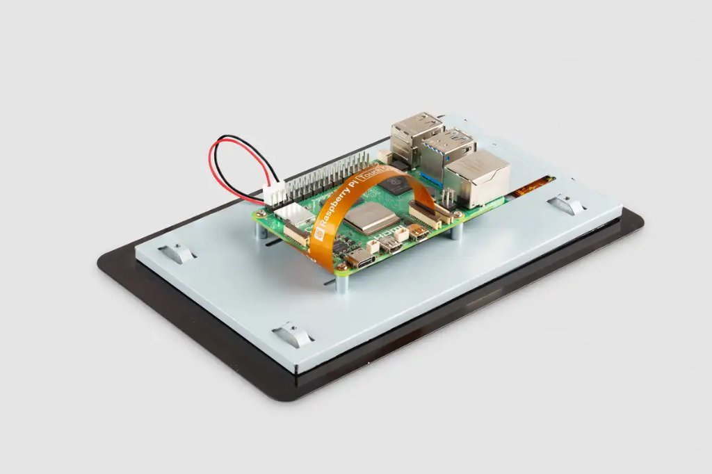

# Subsystem Description

The light subsystem encapsulates two main parts, the LEDs to indicate internal states and lead attention, and the LCD display, which helps in the anthropomorphization of the ARMoD as well as to convey attention and gaze.

## LEDs
The LEDs need to be clearly seen and interpreted from a reasonable interaction distance (around 3m to 5m), convey the internal states, and, as with the rest of the ARMoD, be commercially accessible or easy to replace. 

Several LED form factors are available off the shelf but to meet the project requirements, addressable 5050 RGB LEDs based on the WS2812B-V5 were chosen, arranged (provisionally) as a single LED ring mounted in the centre of the chest. As has been done in other robotic projects, grouping emitters behind a translucent diffuser helps blend the individual diodes into a uniform glowing ring, providing enough lit surface area and contrast to be spotted easily, while also allowing animated cues and other dynamic indicators. 

Because WS2812B-V5 rings, rigid bars, and flexible strips all share the same 3-pin interface (5 V, data, and ground), the chest ring can also be replaced by a different layout in future iterations without changing the electronics or firmware heavily.

## LCD Display
The task of the screen is to represent the face of the ARMoD, predominantly its eyes, and open the path for displays of any other relevant information in the future. There is a limited share of options regarding the selection of a display that can be integrated in an embedded system, compatible with a Raspberry Pi 5, within a reasonable quality-size-cost design space, and, most importantly, widely available for the replication of the project.

The display that meets these specifications, specially regarding the stock availability of the product, is the Raspberry Pi Touch Display 2. While the touch functionality is not necessary for the initial concept of the ARMoD and its requirements, it once again opens possibilities in the fields of HRI studies. 

The screen module uses a DSI connection, to transmit touch data and receive video information, and a GPIO connection, to receive power at 5V, to the Raspberry Pi 5. The screen size is selectable, with the one chosen for the ARMoD being 7''.

{: width=48% }
{: width=48% }
{: .center }

*Figure 1: Raspberry Pi Touch Display 2: front view (left) and rear view with a Raspberry Pi 5 mounted and connected via DSI and GPIO (right).*
{: .center }
