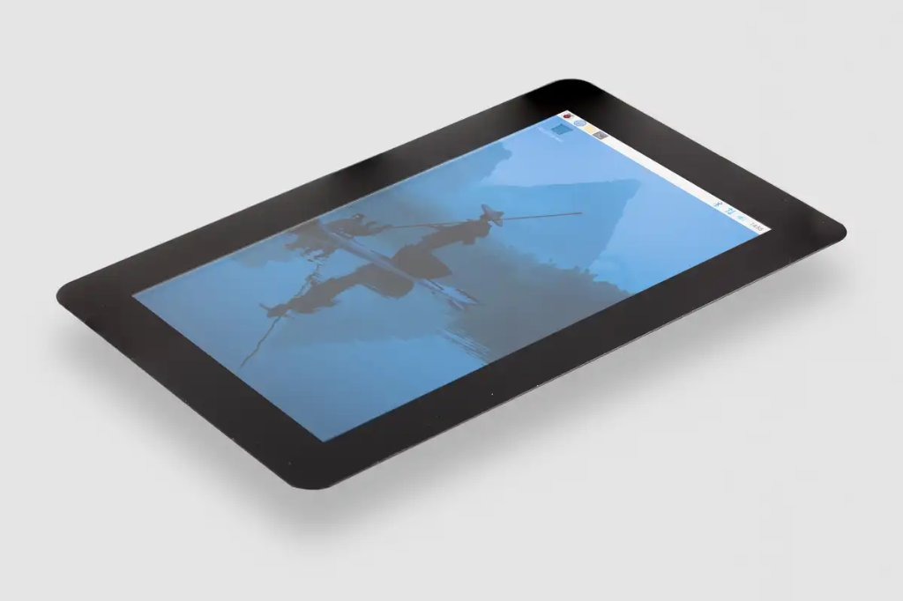

# Subsystem Description

The task of the screen is to represent the face of the ARMoD, predominantly its eyes, and open the path for displays of any other relevant information in the future. There is a limited share of options regarding the selection of a display that can be integrated in an embedded system, compatible with a Raspberry Pi 5, within a reasonable quality-size-cost design space, and, most importantly, widely available for the replication of the project.

The display that meets these specifications, specially regarding the stock availability of the product, is the Raspberry Pi Touch Display 2. While the touch functionality is not necessary for the initial concept of the ARMoD and its requirements, it once again opens possibilities in the fields of HRI studies. 

The screen module uses a DSI connection, to transmit touch data and receive video information, and a GPIO connection, to receive power at 5V, to the Raspberry Pi 5. The screen size is selectable, with the one chosen for the ARMoD being 7''.

{: width=48% }
{: width=48% }
{: .center }

*Figure 1: Raspberry Pi Touch Display 2: front view (left) and rear view with a Raspberry Pi 5 mounted and connected via DSI and GPIO (right).*
{: .center }
