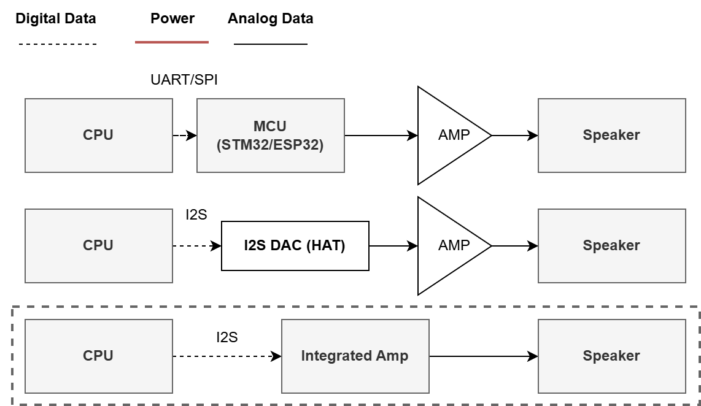
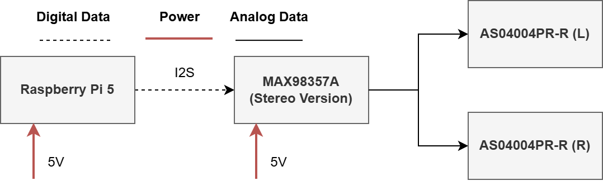

# Subsystem Description

## Introduction

The Audio subsystem provides the ARMoD with its voice and acoustic capabilities, reproducing synthesised Text-to-Speech (TTS) phrases and short auditory alerts to communicate navigation intent, upcoming motions, and internal states. Spoken messages complement visual modalities, as sound reaches people nearby even when there is no direct line of sight to the robot. In addition, the subsystem includes a microphone input to sample ambient background noise so playback volume can be adapted to the surrounding environment, while leaving the hardware open for future Human-Robot Interaction (HRI) voice studies.

From an acoustic standpoint, the design is guided by four requirements: maintaining a speech Sound Pressure Level (SPL) at least 10 dB above ambient noise at interaction distances up to 5 m where feasible, keeping speech qualitatively intelligible across normal interaction ranges, covering the primary speech band from 300 Hz to 7 kHz without excessive distortion, and adapting output gain to background noise rather than at a fixed level. 

Sizing the speakers to overpower heavy factory machinery would contradict the goal of replacing industrial alarms with multimodal cues, and European workplace noise regulations already limit daily exposure to 87 dBA, so the target is not to design a speaker system for this specific industrial setting. Therefore, an urban street environment is treated as the worst-case design scenario. In the following subsections, the selection of the audio playback topology, amplification stage, speaker drivers, and microphone is discussed alongside the subsystem architecture.

## Playback Topology and Amplifier Selection

Although the component-agnostic system architecture separates digital-to-analog conversion and amplification conceptually into a Digital-to-Analog Converter (DAC) and an amplifier (AMP), three topologies were evaluated to route audio from the Single-Board Computer (SBC) to the speakers, as shown in Figure 1.

{: .center }

*Figure 1: Candidate audio playback topologies evaluated for the ARMoD, with the selected integrated I2S amplifier architecture highlighted at the bottom.*
{: .center }

### MCU-Mediated Playback

In the first topology (`CPU → UART/SPI → MCU → AMP → Speaker`), the SBC streams audio data over UART or SPI to the MCU, which reconstructs an analog signal using its internal DAC or Pulse-Width Modulation (PWM) to feed a discrete analog amplifier. This option was discarded because streaming continuous audio adds serial bus traffic and interrupt load on the MCU, which is already reserved for servo control, LED driving, and power monitoring. Since the Raspberry Pi 5 generates the TTS stream directly in Linux and has a native Inter-IC Sound (I2S) digital audio bus on its GPIO header, routing audio through the MCU introduces unnecessary complexity.

### Standalone I2S DAC and Analog Amplifier

The second topology (`CPU → I2S → I2S DAC (HAT) → AMP → Speaker`) pairs a Raspberry Pi `I2S` DAC HAT board with an external Class-D analog amplifier IC. While separating conversion from amplification allows higher supply voltages and dedicated analog tuning, full-size HAT boards cover the entire 40-pin GPIO header. Splitting the stage into two boards also increases wiring bulk inside the compact torso.

### Integrated I2S Class-D Amplifier

The third topology (`CPU → I2S → Integrated Amp → Speaker`) uses a digital-input Class-D amplifier IC that integrates the `I2S` DAC and power output stage in one device. Keeping the signal in the digital domain up to the amplifier input eliminates analog line noise and requires only three `I2S` lines, alongside the 5 V supply and ground.

Within this family, the **`MAX98357A`** was selected, delivering up to 3.2 W per channel into a 4 Ω load from the 5 V rail with Class-D efficiency. For initial prototyping, two `Adafruit MAX98357A` breakout boards (`ADA3006`) are connected on the shared `I2S` bus in a stereo configuration.

## Speaker and Microphone Selection

To match the 3.2 W into 4 Ω output capability of each `MAX98357A` channel while fitting inside the ≤ 50 cm 3D-printed body, commercially available 4 Ω miniature and compact full-range speakers were compared across sensitivity (normalised to 1 W / 1 m), resonant frequency ($f_0$), usable bandwidth relative to the 300 Hz to 7 kHz speech band, Total Harmonic Distortion (THD), mass, dimensions, unit price, and distributor availability. The candidate drivers are summarised in Table 1:

| Speaker | Rated Power (W) | Impedance (Ω) | SPL @ 1 W / 1 m (dB) | $f_0$ (Hz) | Frequency Range (Hz) | THD @ 1 kHz (%) | Weight (g) | Dimensions (mm) | Unit Price (€) |
|:---:|:---:|:---:|:---:|:---:|:---:|:---:|:---:|:---:|:---:|
| Adafruit 3968 | 5 | 4 | 78.0 | 150 | 150 – 15,000 | 5 | — | 40 × 40 × — | 5.00 |
| **PUI Audio AS04004PR-R** | **3** | **4** | **80.0** | **180** | **100 – 20,000** | **5** | **25.0** | **Ø 40 × 17.5** | **8.32** |
| Ole Wolff OWS-4021TA-4 | 3 | 4 | 84.0 | 230 | — | — | — | 40 × 40 × 21 | 7.70 |
| CUI CMSM-3116-34 | 3 | 4 | 73.2 | 280 | 280 – 20,000 | 5 | 15.0 | Ø 31.6 × 15.4 | 10.10 |
| Soberton WSP-7704 | 3 | 4 | 82.0 | 330 | 330 – 10,000 | 3 | — | Ø 77.2 × 21 | 5.60 |
| PUI Audio AS07104PO-R | 3 | 4 | 80.0 | 250 | 100 – 20,000 | 5 | 38.0 | 41 × 71 × 25 | 7.40 |
| PUI Audio AS03104MR-F-WP-R | 3 | 4 | 74.0 | 280 | 280 – 20,000 | 10 | 20.0 | 31.2 × 41.2 × 11 | 10.10 |
| PUI Audio AS03204MS-3-R | 3 | 4 | 77.0 | 200 | 200 – 20,000 | 5 | 16.6 | 32 × 32 × 16.5 | 10.70 |
| Visaton SC 5.9 ND | 3 | 4 | 82.0 | 280 | 150 – 17,000 | — | 60.0 | 50 × 90.5 × 28.5 | 14.00 |

*Table 1: Comparison of candidate 4 Ω speakers evaluated for the ARMoD audio subsystem.*

### Speaker Drivers

Low-cost pre-enclosed hobby sets are inexpensive and simple to mount, but exhibit relatively poor voice clarity. Ultra-compact micro speakers save mass (15 g to 20 g) and internal space, yet drop sensitivity to 73.2–77.0 dB (1 W / 1 m) with high resonant frequencies (200 Hz to 280 Hz) and up to 10 % THD, which reduces speech intelligibility in noisy surroundings. At the other end, larger units such as the `Soberton WSP-7704` and drivers like the `Visaton SC 5.9 ND` bigger enclosures and mounting space.

Within the 40 mm class, the `OWS-4021TA-4` presents a higher nominal sensitivity (84.0 dB) but has a higher 230 Hz resonance and incomplete bandwidth and distortion specifications, whereas the `AS07104PO-R` is heavier (38 g) and larger (71 mm long) for the same 80.0 dB sensitivity. The **PUI Audio `AS04004PR-R`** (3 W rated, 4 W peak, 4 Ω) was therefore chosen. It combines 80.0 dB sensitivity at 1 W / 1 m (specified in the datasheet as 86.0 ± 3 dB at 1 W / 0.5 m) with a 180 Hz resonant frequency, a 100 Hz to 20,000 Hz range that covers the 300 Hz to 7 kHz speech band at ≤ 5 % THD, and steady stock at roughly €8.3 per driver.

### Microphone

To support ambient noise adaptation, the audio subsystem requires an acoustic input on the SBC. For initial development, an off-the-shelf **plug-and-play USB mini microphone** (`BerryBase 125147` connected to the Raspberry Pi 5 via USB) was selected so background sound levels can be sampled directly in Linux without designing an analog preamplifier. 

The integrated microphone on the backup USB webcam also remains available for bench testing. In future revisions, this USB module can be replaced by a compact digital `I2S` or analog MEMS microphone integrated directly into the ARMoD shell.

## Functional Architecture

Figure 2 illustrates the physical architecture of the Audio subsystem. Dashed black arrows denote digital data links, solid black arrows denote analog speaker signals, and solid red arrows represent the 5 V power rails supplied by the voltage regulators. 

{: .center }

*Figure 2: Defined playback architecture of the ARMoD audio subsystem.*
{: .center }
