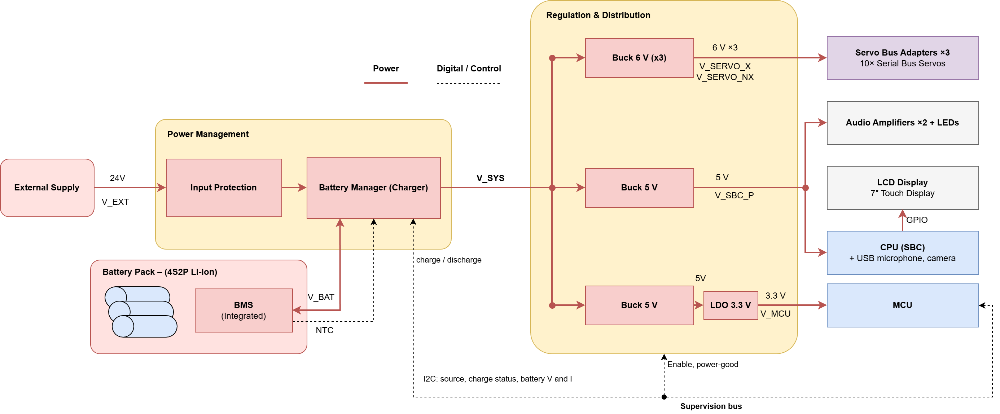

# Subsystem Description

## Introduction

The electrical system of the ARMoD, due to the intended agnostic nature, cannot assume that every host vehicle exposes regulated low-voltage buses for its operation. The Power subsystem therefore both stores energy onboard for untethered operation through a battery and accepts an external DC supply, which also charges the battery. In any case the subsystem steps the supply down for the actuators, processors, and peripherals while providing information on electrical status to the MCU.

Sizing this distribution network begins with estimating how much current and power each subsystem draws under both typical duty-weighted operation and worst-case peak demand, then separating the regulated rails so motor transients do not disturb sensitive digital or audio electronics. In the following subsections, the system power budget, voltage rail allocation, battery and external supply selection, and overall power architecture are discussed.

## Power Budget

To size the power sources and voltage regulators, a component-level power budget was compiled from component datasheets and estimates for each subsystem. For every load, idle and active power figures were weighted by estimated operating duty cycles to obtain a mean current ($\bar{I}$) and mean power ($\bar{P}$), alongside worst-case peak current ($I_{\max}$) and peak power ($P_{\max}$). The resulting load breakdown is summarised in Table 1:

| Subsystem / Load | Component | Qty | Voltage (V) | $\bar{I}$ (A) | $I_{\max}$ (A) | $\bar{P}$ (W) | $P_{\max}$ (W) |
|:---:|:---:|:---:|:---:|:---:|:---:|:---:|:---:|
| Actuation | STS3215-C044 Servos | 10 | 6.0 | 2.03 | 5.56 | 12.17 | 33.36 |
| Computing (SBC) | Raspberry Pi 5 (8 GB) | 1 | 5.0 | 1.18 | 1.76 | 5.90 | 8.80 |
| Computing (MCU) | STM32F446RE | 1 | 3.3 | 0.07 | 0.09 | 0.23 | 0.28 |
| Vision | Raspberry Pi Camera Module 3 | 1 | 5.0 | 0.23 | 0.25 | 1.13 | 1.25 |
| Light (Display) | 7" LCD Display | 1 | 5.0 | 0.22 | 0.50 | 1.10 | 2.50 |
| Light (LEDs) | Addressable RGB LEDs (est.) | 10 | 5.0 | 0.20 | 0.60 | 1.00 | 3.00 |
| Audio (Output) | 2× AS04004PR-R + 2× MAX98357A | 1 set | 5.0 | 0.06 | 0.40 | 0.32 | 2.00 |
| Audio (Input) | USB Mini Microphone | 1 | 5.0 | 0.04 | 0.10 | 0.18 | 0.50 |
| Cooling | SBC Active Cooler Fan | 1 | 5.0 | 0.10 | 0.20 | 0.50 | 1.00 |
| **Total Load** | — | — | — | — | — | **22.52** | **52.69** |

*Table 1: Component-level average and peak power budget of the ARMoD.*

Two points stand out from Table 1. First, the ten serial bus servos dominate the robot's electrical demand, accounting for 12.17 W (54 %) of the 22.52 W average load and 33.36 W (63 %) of the 52.69 W peak load. Their consumption was modelled over a representative duty cycle, with 10 % off (0 W), 60 % idle (0.06 A per joint, or 3.60 W total), and 30 % holding under worst-case arm and head torque with a safety factor of two (33.36 W). Note that continuous full-stall current is excluded, as the smart servos limit can torque/current if a joint stalls. Second, the Raspberry Pi 5 represents the largest steady load at 5.90 W on average (assuming a 50 % split between 3.0 W idle and 8.8 W active operation), whereas all remaining peripherals combined add roughly 4.2 W on average and the MCU itself remains below 0.3 W.

Note that these numbers are estimations, and serve only design purposes, with reconsiderations perchance necessary on measurement on actual hardware.

## Voltage Rails

The loads in Table 1 require three distinct voltage levels: 6.0 V for the actuators, 5.0 V for the SBC and peripherals, and 3.3 V for the MCU. Rather than running all actuators or all electronics from a single regulator per voltage, the distribution network divides the loads across five primary step-down buck stages and one cascaded Low-Dropout regulator (LDO). Factoring in a conservative 90 % efficiency for the switching buck stages and 66 % efficiency for the 5.0 V to 3.3 V (given the voltage drop) LDO gives the total power drawn from the intermediate system bus (`V_SYS`), as listed in Table 2:

| Rail | Supplied Loads | Voltage (V) | Stage Type | Efficiency (%) | Load $\bar{P}$ (W) | Load $P_{\max}$ (W) | Load $I_{\max}$ (A) | Input $\bar{P}_{\text{in}}$ (W) | Input $P_{\text{in,max}}$ (W) |
|:---:|:---:|:---:|:---:|:---:|:---:|:---:|:---:|:---:|:---:|
| `V_SERVO_A1` | Left Arm Servos (4×) | 6.0 | Buck | 90 | 5.40 | 15.12 | 2.52 | 6.00 | 16.80 |
| `V_SERVO_A2` | Right Arm Servos (4×) | 6.0 | Buck | 90 | 5.40 | 15.12 | 2.52 | 6.00 | 16.80 |
| `V_SERVO_N` | Neck Servos (2×) | 6.0 | Buck | 90 | 1.37 | 3.12 | 0.52 | 1.52 | 3.47 |
| `V_SBC_P` | SBC, Display, Camera, Audio, LEDs, Fan | 5.0 | Buck | 90 | 10.12 | 19.05 | 3.81 | 11.25 | 21.17 |
| `V_MCU` | Pre-regulator for MCU LDO | 5.0 | Buck | 90 | 0.34 | 0.43 | 0.09 | 0.38 | 0.48 |
| `V_MCU (LDO)` | STM32F446RE MCU *(cascaded)* | 3.3 | LDO | 66 | 0.23 | 0.28 | 0.09 | *(0.34)* | *(0.43)* |
| **Total (`V_SYS`)** | — | — | — | — | — | — | — | **25.15** | **58.71** |
| **Design Target** | *With headroom margin* | — | — | — | — | — | — | **30.00** | **70.00** |

*Table 2: Regulated voltage rails, conversion efficiencies, and total input power on the intermediate system bus (`V_SYS`).*

### Split 6 V Actuation Rails (`V_SERVO_A1`, `V_SERVO_A2`, `V_SERVO_N`)

The `STS3215-C044` servos are originally designed to be supplied at 6.0 V, which provides enough torque and angular speed, while still opening the possibility of using smaller servos when available on the neck and elbow. Instead of feeding all ten joints from a single high-current regulator, the actuation power is split into three independent 6.0 V buck rails, one for the left arm (`V_SERVO_A1`), one for the right arm (`V_SERVO_A2`), and one for the neck (`V_SERVO_N`). 

### Shared 5 V Compute and Peripheral Rail (`V_SBC_P`)

The Raspberry Pi 5 (along with its Camera Serial Interface (CSI) camera, USB mini microphone, and cooling fan), the 7-inch Touch Display 2, the `MAX98357A` stereo audio amplifiers, and the Light-Emitting Diodes (LEDs) all require a regulated 5.0 V supply. Together they draw 10.12 W on average and up to 19.05 W (3.81 A) at peak (albeit the Rasp Pi requires 5A minimum for some transients). Grouping these loads on a dedicated `V_SBC_P` buck rail keeps the component count low while keeping digital logic, video, and audio amplification decoupled from the voltage dips on the three 6.0 V servo buses.

### Isolated 3.3 V Microcontroller Rail (`V_MCU`)

Although the `STM32F446RE` MCU draws less than 0.3 W, it receives its own two-stage regulation path (`V_SYS` → 5.0 V buck → 3.3 V LDO). Dropping the unregulated bus voltage (around 12 V to 24 V) straight down to 3.3 V with a linear regulator alone would waste most of the input power as heat, so an intermediate 5.0 V buck stage handles the bulk step-down before the 3.3 V LDO filters switching ripple for the MCU core and analog peripherals. Keeping `V_MCU` completely separate from `V_SBC_P` and the actuator rails ensures that the microcontroller remains powered to monitor the battery, disable faulty regulators, and override the status LEDs even if the SBC rail or a servo branch experiences a brownout or short circuit. Summing the five primary buck inputs gives a total demand on `V_SYS` of 25.15 W on average and 58.71 W at peak, which is rounded up to design targets of 30 W continuous and 70 W peak.

## Power Sources Selection

As explained in the introduction, to support both mobile operation and continuous benchtop work, the ARMoD combines a rechargeable battery with an external DC power input.

### Battery Pack

Three main battery chemistries were weighed for the internal pack: 

Lithium Polymer (LiPo) pouch packs, which deliver high discharge current at low weight, but lack integrated protection circuitry, are more susceptible to mechanical puncture or swelling, and complicate safe indoor HRI testing and shipping. 

Lithium Iron Phosphate (`LiFePO4`) packs (such as a 4S configuration at 12.8 V nominal), which offer high thermal stability, yet have lower energy densities, taking up more torso space, and certified off-the-shelf packs with integrated protection are less widely stocked by standard electronics distributors. 

And Industrial cylindrical Lithium-Ion (Li-ion) packs, which offer the best compromise between energy density, mechanical durability, stock availability (as well as in-house pack manufacturing), and built-in safety electronics.

With the chemistry decided, series cell count is equally important to determine. A 1S or 2S Li-ion pack (7.4 V nominal) approaches 6.0 V near the bottom of its discharge curve, leaving insufficient headroom for the 6.0 V servo buck regulators to hold output regulation under peak load. A `3S1P` pack (11.1 V nominal, 3000 mAh, roughly 33 Wh) clears the dropout threshold, but at the 25.15 W average bus load it delivers just over one hour of runtime. Moving to a `4S2P` Li-ion configuration (14.54 V nominal, ranging from roughly 12.0 V discharged to 16.8 V fully charged) keeps intermediate bus currents low (around 1.7 A average and 4.0 A peak), guarantees ample step-down headroom for all 6.0 V and 5.0 V buck converters throughout the discharge cycle, and remains safely below a 24 V charging supply. For these reasons, the **`ANSMANN 2447-3035-60`** (`4S2P`, 14.54 V, 5200 mAh, 75.6 Wh) was chose. It includes an integrated Battery Management System (BMS) with cell balancing, overcharge/over-discharge/short-circuit protection, and a Negative Temperature Coefficient (NTC) thermistor, and provides approximately three hours of untethered operation at 25.15 W average load (around 2.5 hours at the 30 W margin target).

### External Supply

An external DC input (`V_EXT`) is included alongside the battery so the ARMoD can run on a workbench without cycling the cells and can recharge the pack in place. Choosing the external supply voltage is driven primarily by the 4S pack's 16.8 V full-charge threshold. A 12 V supply sits below 16.8 V and would require a more complex buck-boost charger to top up the battery, whereas a **24 V DC** input (operating within a 20 V to 24 V window and sized for at least 70 W to 90 W to support simultaneous robot operation and charging) allows a straightforward step-down buck charger using inexpensive off-the-shelf AC/DC adapters.

## Power Architecture

Figure 1 shows the component-agnostic electrical architecture of the Power subsystem. Specific integrated circuit selections and passive component sizing are covered in [Hardware Design](02-hardware-design.md). Solid red lines in the diagram represent power buses and regulated supply rails, whereas dashed black lines represent digital supervision and control signals. Overall, power enters from either the 24 V external supply or the 4S Li-ion pack into the Power Management stage, which feeds the shared intermediate bus (`V_SYS`) that supplies the Regulation and Distribution bank under continuous MCU supervision.

{: .center }

*Figure 1: Component-agnostic electrical architecture of the ARMoD power subsystem.*
{: .center }

### Power Management

The Power Management block sits between the two energy sources and the rest of the robot. On the external input side, an Input Protection stage shields the downstream electronics from reverse polarity, overvoltage transients, and inrush surges on `V_EXT`. Behind it, the Battery Manager (Charger) performs automatic power-path selection between `V_EXT` and `V_BAT` to feed `V_SYS`, runs a controlled step-down charge profile into the battery whenever external 24 V power is present, and exposes source, charge-state, voltage, and current telemetry over a digital link.

### Battery Pack and BMS

The Battery Pack block pairs the `4S2P` Li-ion cell pack with its integrated BMS. While the Battery Manager handles normal charging termination and current limits, the BMS acts as an independent hardware safety barrier inside the pack-monitoring individual cell voltages, balancing cells and disconnecting `V_BAT` automatically if an overvoltage, undervoltage, overcurrent, or thermal limit is exceeded.

### Regulation and Distribution

The Regulation and Distribution stage taps `V_SYS` through per-rail current and voltage sensing and steps it down to the five primary regulated rails: the three 6.0 V buck stages (`V_SERVO_X`, `V_SERVO_NX`) feeding the three servo bus adapter boards and ten `STS3215-C044` servos, the shared 5.0 V buck stage (`V_SBC_P`) feeding the Raspberry Pi 5 (plus camera, microphone, and cooling fan), the 7-inch Touch Display 2, the `MAX98357A` audio stage, and the status LEDs, and the isolated 5.0 V buck followed by a 3.3 V LDO (`V_MCU`) powering the `STM32F446RE` MCU.

### Supervision Bus

The Supervision Bus links the MCU to both Power Management and Regulation and Distribution via I2C and discrete control lines. Through this bus, the MCU reads the active power source, battery voltage and current, charging state, and per-rail current measurements, while toggling regulator `Enable` lines and reading `Power-Good` flags. If a supply fault or undervoltage condition is detected, the MCU can shut down affected rails, override normal LED patterns locally to signal an error, and forward updated power telemetry to the Raspberry Pi 5.
