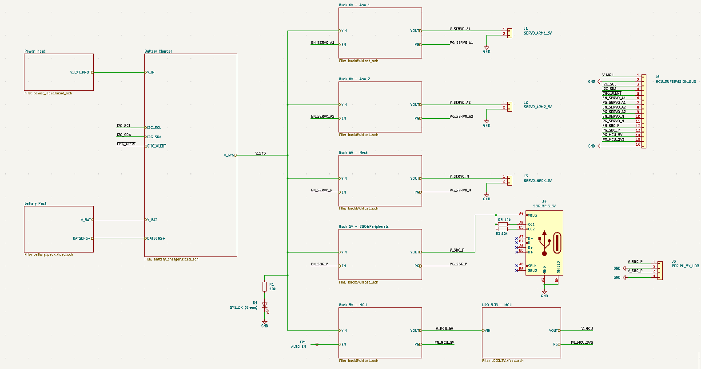
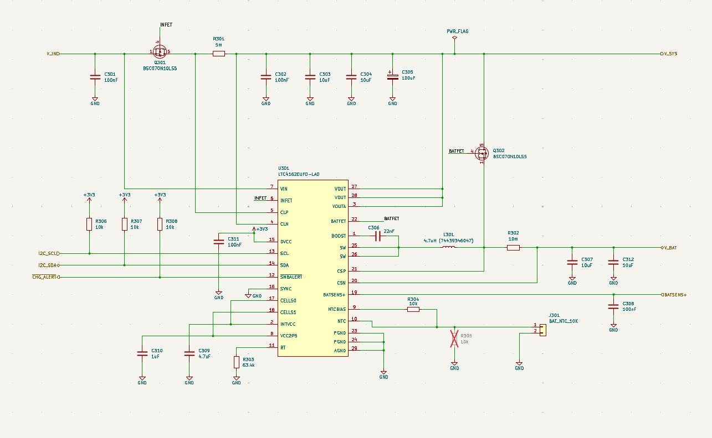
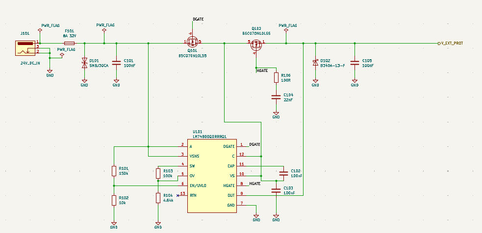
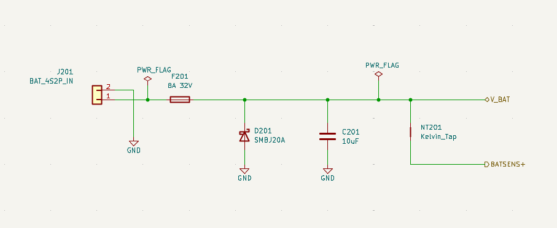

# Hardware Design

## Introduction
Given the rail distribution presented in the subsystem description, the power management ICs are selected to meet the electrical requirements of both the loads and the battery pack. For the buck converters, the selected IC is the Texas Instruments TPS56637 (`TPS56637RPAR`), a 4.5 V to 28 V input, 6 A synchronous step-down converter with enable and power-good signaling, while the LDO supplying the MCU is the onsemi NCP164C (`NCP164CSN330T1G`), a 300 mA fixed 3.3 V ultra-low-noise linear regulator with an open-drain power-good output. Battery management and charging are handled by the Analog Devices LTC4162-L (`LTC4162EUFD-LAD`), a 35 V, 3.2 A multi-cell Li-Ion synchronous step-down charger featuring integrated PowerPath control and I2C telemetry.

To protect the converters and downstream electronics, input protection is managed by the Texas Instruments LM74800-Q1 (`LM74800QDRRRQ1`), an ideal diode controller driving external back-to-back N-channel MOSFETs to provide reverse-polarity, reverse-current, and overvoltage protection, complemented by an 8 A input fuse and a TVS diode.

This section presents the schematic and circuit design of the electrical power supply (EPS), followed by an overview of the PCB layout. The top-level hierarchical schematic of the complete power system is shown below:

{: .center }
*Top-level hierarchical schematic of the ARMoD v2 Electrical Power Supply (EPS), showing input protection, battery management, regulated power rails, and the MCU supervision bus.*{: .center }

## Circuit Design

### LDO

The design of the EPS starts at the loads and progresses upstream toward the input. The first stage in this backward chain is the 3.3 V LDO (`U901`, NCP164CSN330T1G) supplying the MCU. 

Its circuit closely follows the typical application schematic provided by the manufacturer, with its enable (`EN`) pin tied directly to `VIN` so that the regulator starts automatically as soon as the upstream 5 V MCU rail comes up.The open-drain power-good (`PG`) pin is pulled up to 3.3 V via a 100 kΩ resistor (`R901`) and is pulled low by the IC during startup or in the event of an output fault (falling below 90% of nominal voltage) to be monitored by the MCU. 

In addition to the standard 1 µF ceramic decoupling capacitors (`C901`, `C903`), 10 µF bulk ceramic capacitors (`C902`, `C904`) are placed at both the input and output to improve line and load transient performance in accordance with the datasheet recommendations.

The resulting schematic can be seen in the following figure:

{: .center }
*Schematic of the 3.3 V MCU LDO regulator stage (`NCP164CSN330T1G`) with input/output bulk decoupling and open-drain Power-Good pull-up.*{: .center }

### Buck Converters (5V)

Following the LDO, the two 5 V buck converter stages (one dedicated to the MCU, `U801`, feeding the 3.3 V LDO, and one supplying the Raspberry Pi 5 SBC and 5 V peripherals, `U701`) are designed using a shared hierarchical block based on the TPS56637. The manufacturer's 5 V, 6 A reference design meets the ARMoD requirements almost directly, retaining the 73.2 kΩ / 10 kΩ feedback network (with a 20 kΩ and 100 pF feedforward path), the 3.3 µH inductor, Eco-mode light-load selection (`MODE` tied to ground via a 0 Ω jumper), and a 100 kΩ `PG` pull-up referenced to 3.3 V.

The main deviations from the reference schematic lie in omitting the optional 49.9 Ω `R5` resistor (used only on evaluation boards for control-loop Bode measurements) and adjusting the `EN` pin voltage divider (`OV/UVLO` network) by keeping the upper resistor (`R701`/`R801`, `R1` in the reference schematic) at 169 kΩ while reducing the lower pull-down resistor (`R702`/`R802`, `R2` in the reference schematic) from 36.1 kΩ to 22.1 kΩ.

This modification shifts the input UVLO thresholds from the reference design's 6.54 V / 5.52 V up to a rising turn-on threshold of approximately 10.03 V and a falling turn-off threshold of approximately 8.84 V (providing ~1.19 V of hysteresis). Raising these thresholds prevents the converters from operating into deep battery discharge or input brownout conditions while maintaining sufficient hysteresis against load-induced voltage droop on `V_SYS`. At the same time, reducing the lower resistor to 22.1 kΩ limits the divided `EN` pin voltage to roughly 2.87 V under a 24 V external input (and ~3.34 V at the converter's 28 V maximum input rating, down from 4.37 V and 5.08 V with the original 36.1 kΩ resistor), protecting both the `EN` pin and any directly connected 3.3 V MCU GPIO from overvoltage without external clamping diodes.

Enable control is differentiated at the top-level schematic between the two 5 V rails. For the MCU 5 V converter (`U801`), the `EN` node is left unconnected to external logic (exposed only on test point `AUTO_EN`), allowing the converter to auto-enable through its UVLO divider whenever `V_SYS` exceeds 10.03 V so that the MCU and its 3.3 V LDO always boot autonomously. 

Conversely, for the SBC and peripherals 5 V converter (`U701`), the `EN` node (`EN_SBC_P`) is routed to an open-drain GPIO on the MCU supervision bus. When the MCU releases this line to high impedance, `U701` operates normally under hardware UVLO control; when the MCU pulls `EN_SBC_P` low (below the 1.12 V falling threshold), it overrides the divider and forces the converter into standby shutdown, enabling power-up sequencing as well as selective load shedding of the SBC and peripherals during faults or low-battery states.

The resulting schematic can be seen in the following figure:

{: .center }
*Schematic of the 5 V, 6 A synchronous buck converter stage (`TPS56637RPAR`) with modified 169 kΩ / 22.1 kΩ EN/UVLO divider and open-drain enable/Power-Good supervision.*{: .center }

### Buck Converters (6V)

The design of the three 6 V buck converters powering the servo rails (`Arm 1`, `Arm 2`, and `Neck`) closely follows the 5 V stage, with three targeted adjustments. 

First, the feedback resistor divider is updated to 180 kΩ (`R403`) and 20 kΩ (`R404`) to regulate the output to 6.0 V (given the 0.6 V internal reference) while retaining the 20 kΩ / 100 pF feedforward network.

Second, the `EN` pin configuration is changed from a `VIN` UVLO divider to a single 100 kΩ pull-down resistor to ground (`R401`); this overcomes the TPS56637's internal 1 µA enable pull-up current so that the servo rails remain safely disabled by default at startup and during MCU reset until explicitly driven high by the MCU (`EN_SERVO_A1`, `EN_SERVO_A2`, `EN_SERVO_N`).

Third, the output inductance is increased from 3.3 µH to 5.6 µH (`IHLP3232`) in accordance with the datasheet guideline for unlisted output voltages, which specifies selecting the LC filter values of the next higher listed rail (12 V) to preserve loop stability and limit inductor current ripple.

The resulting schematic can be seen in the following figure:

{: .center }
*Schematic of the 6 V, 6 A synchronous buck converter stage (`TPS56637RPAR`) for the servo rails, configured with a 180 kΩ / 20 kΩ feedback divider, 5.6 µH output inductor, and normally-off 100 kΩ EN pull-down.*{: .center }

### Battery Charger and Selection

Continuing upstream from the buck converters, the intermediate rail (`V_SYS`) is managed by the Analog Devices `LTC4162EUFD-LAD` (`U301`), a 35 V, 3.2 A synchronous step-down Li-Ion charger with PowerPath control and I2C telemetry. The PowerPath stage separates `V_SYS` (the IC's `VOUT` node) from `V_BAT` using two external N-channel MOSFETs (`INFET` and `BATFET`). This allows the system to start immediately from external power even when the battery is discharged, reduces charge current to prioritize system load near the input limit, and supplements `V_SYS` from the battery during load peaks.

#### Specifications, Pin-Strapping, and Current Sensing

The circuit is designed for a 4S2P Li-Ion pack (12.0 V empty, 14.8 V nominal, 16.8 V full at 4.2 V/cell, up to 5400 mAh with an internal BMS for cell balancing) and a 24 V, 6.25 A external DC supply. The system draws ~30 W on average and up to ~70 W peak (~2.9 A from 24 V, or ~6.5 A from a 12 V pack). Charging at 3.2 A requires $16.8\text{ V} \times 3.2\text{ A} = 53.8\text{ W}$ (~2.4 A from 24 V at ~94% efficiency), giving a combined peak input current of ~5.3 A.

Because the `-LAD` variant begins charging on power-up before I2C configuration, the cell count must be set in hardware. `CELLS0` is tied to `INTVCC` and `CELLS1` to `VCC2P5` for 4S operation ($V_{\text{CHG}} = 4 \times 4.2\text{ V} = 16.8\text{ V}$). `SYNC` is tied to `AGND`, and `R303` (63.4 kΩ, 1%) on `RT` sets the switching frequency to ~1.5 MHz:

$$f_{\text{OSC}}(\text{MHz}) = \frac{94}{R_T(\text{k}\Omega)} = \frac{94}{63.4} \approx 1.48\text{ MHz}$$

Input and charge current limits are set by two Kelvin-sensed shunt resistors regulated to 32 mV at full scale:

$$I_{\text{MAX}} = \frac{32\text{ mV}}{R_{\text{SNS}}}$$

* **Charge sense (`R302`):** A 10 mΩ (1206, 1%, 1 W) resistor between `CSP` and `CSN` sets the 3.2 A charge limit. Because `BATFET` connects to `CSP`, peak battery discharge (~6.5 A) also flows through `R302`, dissipating $P = (6.5\text{ A})^2 \times 10\text{ m}\Omega \approx 0.42\text{ W}$, so a 1 W part is used.
* **Input sense (`R301`):** A 5 mΩ (1206, 1%) resistor between `CLP` and `CLN` on the drain side of `INFET` sets a 6.4 A hardware ceiling at boot. Firmware reduces this limit to 6.0 A over I2C (`iin_limit_target = 59`) to stay below the 6.25 A supply rating.

#### Power Stage and Passives

Both PowerPath switches (`Q301` for `INFET`, `Q302` for `BATFET`) use the Infineon `BSC070N10LS5` (100 V N-channel MOSFET, $R_{\text{DS(on)}} = 7.7\text{ m}\Omega$ typical / $8.5\text{ m}\Omega$ max at $V_{\text{GS}} = 4.5\text{ V}$, $Q_g = 16\text{ nC}$), the same MOSFET used in the input protection stage. Both drains connect to `V_SYS` so their body diodes point into `V_SYS`, blocking back-feeding between `V_IN` and `V_BAT` while allowing immediate diode-OR switchover. The 100 V rating handles the full 24 V across `BATFET` if the battery is shorted or disconnected, and the 4.5 V rating matches the IC's 5 V gate drive ($P \le 0.36\text{ W}$ at 6.5 A).

The buck inductor is sized from the datasheet formula and requires at least 30% saturation margin above 3.2 A ($I_{\text{SAT}} \ge 1.3 \times 3.2\text{ A} = 4.16\text{ A}$):

$$L(\mu\text{H}) \approx \frac{0.3 \cdot V_{\text{IN(max)}}}{f_{\text{OSC}}(\text{MHz})} = \frac{0.3 \times 24}{1.5} = 4.8\text{ }\mu\text{H}$$

Based on this, `L301` is a Würth Elektronik 4.7 µH inductor (`74439346047`, $I_{\text{SAT}} = 6.5\text{ A}$, $I_R = 7.4\text{ A}$, $R_{\text{DC}} = 13\text{ m}\Omega$ typical).

Capacitors are selected as follows:

* **`V_SYS` decoupling and damping:** Two 10 µF 1206 X7R ceramic capacitors (`C303`, `C304`, rated 50 V to reduce DC-bias loss at 24 V) handle local 1.5 MHz switching currents. A 100 µF aluminum electrolytic capacitor (`C305`) adds linear capacitance and ESR to damp hot-plug ringing from the battery or input leads, keeping voltage spikes below the 32 V absolute maximum of the downstream `TPS56637` converters.
* **`V_BAT` decoupling and sensing:** Two 10 µF 1206 X7R ceramic capacitors (`C307`, `C312`) decouple `V_BAT` on the `CSN` side to maintain at least 10 µF effective capacitance at 16.8 V. `BATSENS+` is routed as a separate Kelvin trace to the battery connector net-tie (`NT201`) and bypassed locally with `C308` (100 nF).
* **IC bypass capacitors:** Datasheet values are used for `C306` (22 nF, `BOOST` to `SW`), `C309` (4.7 µF, `INTVCC`), `C310` (1 µF, `VCC2P5`), `C301` (100 nF, `VIN`), `C302` (100 nF, `VOUTA`), and `C311` (100 nF, `DVCC`).

#### Temperature Sensing and I2C Interface

Because the battery pack has no built-in thermistor, an external 10 kΩ NTC probe ($\beta_{25/85} \approx 3435\text{ to }3490\text{ K}$) connects to `J301` (`BAT_NTC_10K`) with a 10 kΩ (1%) bias resistor (`R304`) to `NTCBIAS`. A DNP 10 kΩ resistor (`R305`) is included in parallel for bench testing without the probe. No filter capacitor is placed on `NTC` because `NTCBIAS` is pulsed for ~1.6 ms during ADC sampling, and added capacitance would delay settling and distort the temperature reading. Open or shorted NTC wires stop charging.

`DVCC` connects to the 3.3 V MCU rail to set the logic level for `SCL`, `SDA`, and `~CHG_ALERT` (`SMBALERT`), each pulled up to 3.3 V with a 10 kΩ resistor (`R306`, `R307`, `R308`). The IC uses fixed 7-bit address `0x68`. Since I2C registers are volatile and JEITA is enabled at boot, firmware re-writes the 6.0 A input limit and any custom JEITA charge voltage at startup, and toggles `force_telemetry_on` periodically when on battery to sample telemetry. Ship Mode is not used because standby battery draw is ~54 µA and downstream rails are controlled through their enable pins.

The resulting schematic is shown below:

{: .center }
*Schematic of the `LTC4162EUFD-LAD` 4S Li-Ion battery charger and PowerPath stage (`U301`).*{: .center }

### Input Protection

At the 24 V barrel-jack input (`J101`), protection against reverse polarity, reverse current, overvoltage, and startup inrush is handled by the Texas Instruments `LM74800-Q1` (`U101`, `LM74800QDRRRQ1`) driving two back-to-back N-channel MOSFETs (`Q101`, `Q102`) in a common-drain configuration. The design follows the manufacturer's reference circuit with threshold and slew-rate components adapted for a 24 V, 150 W (6.25 A) input feeding the `LTC4162` and downstream `TPS56637` converters.

#### Topology, Fuse, and Surge Clamping

The `LM74800-Q1` variant is selected over the `LM74801-Q1` because its linear `DGATE` control blocks reverse current smoothly on a DC adapter input without requiring hysteretic AC rectification. In the common-drain topology, `Q101` (`DGATE`) sits at the input to block reverse current and reverse polarity (pulling its gate to the `A` pin so $V_{\text{GS}} = 0\text{ V}$), while `Q102` (`HGATE`) disconnects the output during overvoltage or undervoltage faults and limits startup inrush.

Front-end fault protection consists of three discrete components:

* **Fuse (`F101`):** An 8 A fuse at `J101` protects against hard faults above the 6.25 A operating current, while steady-state current limiting is handled by the downstream `LTC4162`.
* **Input TVS (`D101`):** A bidirectional `SMBJ30CA` ($V_{\text{RWM}} = 30\text{ V}$, $V_C = 48.4\text{ V}$) clamps transients below the 65 V IC and 100 V MOSFET limits without conducting during normal 24 V or reversed -24 V connection.
* **Output clamp (`D102`):** A 40 V Schottky diode (`B340A-13-F`) on `V_EXT_PROT` clamps negative inductive spikes during fast `HGATE` turn-off.

#### MOSFETs, Thresholds, and Inrush Control

Both `Q101` and `Q102` use the Infineon `BSC070N10LS5` (100 V $V_{\text{DSS}}$, $\pm 20\text{ V}$ $V_{\text{GS}}$, 7 mΩ max $R_{\text{DS(on)}}$ at 10 V, $C_{\text{iss}} = 2.7\text{ nF}$ max), shared with the battery charger stage. The 100 V rating covers transient clamping and wrong-adapter voltages, the $\pm 20\text{ V}$ gate rating accommodates the ~12 V charge pump, and the low $R_{\text{DS(on)}}$ limits steady-state loss at 6.25 A to ~0.27 W per MOSFET at 25 °C (~0.44 W hot).

The undervoltage lockout (`EN/UVLO`) and overvoltage (`OV`) cutoffs are set with resistor dividers around the IC's 1.231 V rising (1.132 V falling) threshold:

$$V_{\text{UVLO,rise}} = 1.231\text{ V} \times \left(1 + \frac{R_{101}}{R_{102}}\right) = 1.231\text{ V} \times \left(1 + \frac{150\text{ k}\Omega}{10\text{ k}\Omega}\right) \approx 19.7\text{ V}$$

$$V_{\text{OV,rise}} = 1.231\text{ V} \times \left(1 + \frac{R_{103}}{R_{104}}\right) = 1.231\text{ V} \times \left(1 + \frac{100\text{ k}\Omega}{4.64\text{ k}\Omega}\right) \approx 27.8\text{ V}$$

The UVLO window (19.7 V turn-on, 18.1 V turn-off) rejects lower-voltage adapters while leaving margin below 24 V for cable drop. The OV threshold (27.8 V cutoff, 25.5 V recovery) stays above a 24 V supply while disconnecting the rail before the 28 V maximum operating limit (32 V absolute maximum) of the downstream `TPS56637` converters, with total divider resistance ($104.6\text{ k}\Omega$) kept below the 120 kΩ datasheet guideline.

Startup inrush into the downstream capacitance ($C_{\text{OUT(eff)}} \approx 150\text{ }\mu\text{F}$ across `V_SYS`) is controlled by `C104` (22 nF) and `R105` (100 Ω) on `HGATE` ($I_{\text{HGATE}} = 55\text{ }\mu\text{A}$ typical):

$$I_{\text{INRUSH}} = I_{\text{HGATE}} \cdot \frac{C_{\text{OUT}}}{C_{104}} \approx 0.38\text{ A}, \qquad t_{\text{ramp}} = \frac{V_{\text{IN}} \cdot C_{104}}{I_{\text{HGATE}}} \approx 9.6\text{ ms}$$

Because downstream loads remain off during startup, `Q102` only charges the bus capacitance ($E = \frac{1}{2} C_{\text{OUT}} V_{\text{IN}}^2 \approx 43\text{ mJ}$, ~4.5 W average), staying inside its SOA. The remaining passives follow the application schematic: `C102` (100 nF) between `CAP` and `VS` meets the $C_{\text{VCAP}} \ge 10 \times (C_{\text{iss,Q101}} + C_{\text{iss,Q102}}) = 54\text{ nF}$ charge-pump requirement, and 100 nF capacitors decouple `VIN` (`C101`), `VS` (`C103`), and `V_EXT_PROT` (`C105`).

The resulting schematic is shown below:

{: .center }
*Schematic of the 24 V input protection stage (`LM74800QDRRRQ1`) with input fuse, bidirectional TVS, back-to-back `BSC070N10LS5` MOSFETs, UVLO/OV dividers, and `HGATE` inrush control.*{: .center }

### Battery Input Block

The battery input stage interfaces the 4S2P Li-Ion pack (`J201`) with the `LTC4162` charger and provides fault protection and Kelvin voltage sensing:

* **Fuse (`F201`):** An 8 A, 32 V SMD fuse (1206) in series with the battery positive line protects against short circuits and overcurrent faults above the ~6.5 A peak discharge current.
* **TVS diode (`D201`):** A unidirectional `SMBJ20A` ($V_{\text{RWM}} = 20\text{ V}$, $V_C = 32.4\text{ V}$) is placed downstream of `F201` with its cathode on `V_BAT` and anode on `GND`. Its 20 V standoff stays off at the 16.8 V full-charge voltage while clamping positive surges below the `LTC4162`'s 36 V limit. Because the battery input has no reverse-polarity MOSFET, a unidirectional TVS is used so that a reversed battery forward-biases `D201` (~1 V crowbar) and blows `F201` before reverse voltage reaches the charger.
* **Decoupling (`C201`):** A 10 µF (1206) ceramic capacitor decouples the battery rail at the input.
* **Kelvin voltage tap (`NT201`):** A 2-pad SMD net-tie splits `BATSENS+` from `V_BAT` directly after `F201`, giving the `LTC4162` a dedicated sense path to the battery terminal free of high-current PCB trace voltage drop.

{: .center }
*Schematic of the 4S2P battery input block showing the input fuse (`F201`), unidirectional TVS (`D201`), input capacitor (`C201`), and `BATSENS+` Kelvin net-tie (`NT201`).*{: .center }

### Connectors and Top-Level Interfaces

External power connections, regulated outputs, and MCU supervision signals are broken out across dedicated connectors sized for each rail's current and mechanical requirements:

| Designator | Net / Rail | Connector Type | Function |
| :--- | :--- | :--- | :--- |
| `J101` | `24V_DC_IN` | Horizontal DC barrel jack | 24 V, 6.25 A external power input |
| `J201` | `BAT_4S2P_IN` | 2-pin Phoenix MKDS 1.5 screw terminal (5.08 mm) | 4S2P Li-Ion battery pack input |
| `J301` | `BAT_NTC_10K` | 2-pin JST-XH horizontal header (2.50 mm) | External 10 kΩ battery NTC probe |
| `J1`, `J2`, `J3` | `SERVO_ARM1_6V`, `SERVO_ARM2_6V`, `SERVO_NECK_6V` | 2-pin Phoenix PT 1.5 screw terminals (3.50 mm) | Dedicated 6 V outputs (`V_SERVO_A1`, `V_SERVO_A2`, `V_SERVO_N`) and `GND` |
| `J4` | `SBC_RPI5_5V` | 16-pin USB Type-C receptacle (`GCT USB4105`) | 5 V power output (`V_SBC_P`) for the Raspberry Pi 5 |
| `J5` | `PERIPH_5V_HDR` | 1x4 vertical pin header (2.54 mm) | Dual 5 V (`V_SBC_P`) and `GND` pins for peripherals |
| `J6` | `MCU_SUPERVISION_BUS` | 1x16 vertical pin header (2.54 mm) | 3.3 V MCU supply (`V_MCU`), I2C, and rail `EN`/`PG` bus |

On `J4`, only the power pins are connected (data and sideband pins are left unconnected), and both configuration channel pins (`CC1`, `CC2`) are pulled up to `VBUS` through 10 kΩ resistors (`R2`, `R3`) to advertise 5 V, 3 A USB Type-C source capability to the Raspberry Pi 5.

The 16-pin supervision header (`J6`) groups all MCU interfaces onto one connector: `V_MCU` (pin 1), `GND` (pins 2 and 16), the charger I2C and alert lines (`I2C_SCL`, `I2C_SDA`, `~CHG_ALERT`, pins 3 to 5), the enable and power-good pairs for the three servo rails and the SBC/peripherals rail (pins 6 to 13), and the power-good outputs for the MCU 5 V buck and 3.3 V LDO (`PG_MCU_5V`, `PG_MCU_3V3`, pins 14 to 15).

At the top level, a green indicator LED (`D1`, `SYS_OK`) with a 10 kΩ series resistor (`R1`) on `V_SYS` shows when the main bus is energized, and a test point (`TP1`, `AUTO_EN`) provides probing access to the auto-enabled `EN` line of the MCU 5 V buck converter.
