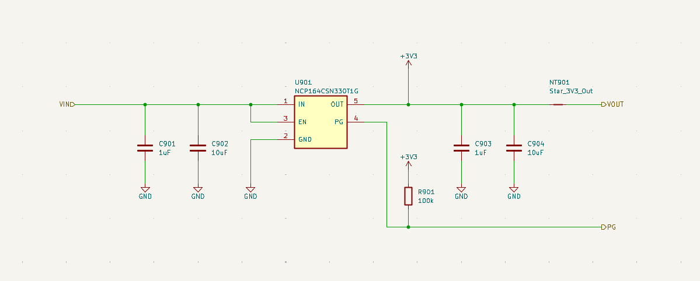
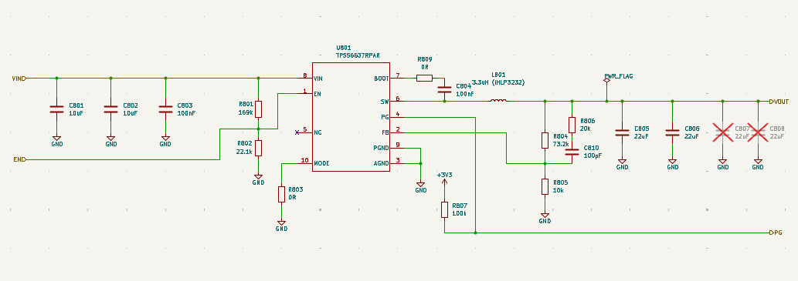
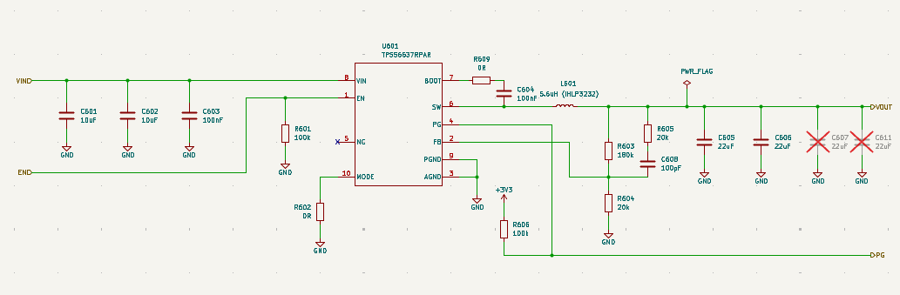

# Hardware Design

## Introduction

Given the rail distribution presented in the subsystem description, ICs are selected to fit the requirements given by the loads and battery. For the buck converters, the selected IC is the Texas Instruments TPS56637 (TPS56637RPAR), a 4.5 V to 28 V input, 6 A synchronous step-down converter with enable and power-good signaling, while the LDO required for the MCU is the onsemi NCP164C (NCP164CSN330T1G), a 300 mA fixed 3.3 V ultra-low-noise linear regulator with a power-good output. The battery manager and charger IC selected is the Analog Devices LTC4162-L (LTC4162EUFD-LAD), a 35 V, 3.2 A multi-cell Li-Ion synchronous step-down charger featuring integrated power path control and I2C telemetry.

In order to protect the converters and downstream chips, input protection is managed by the Texas Instruments LM74800-Q1 (LM74800QDRRRQ1), an ideal diode controller driving external back-to-back N-channel MOSFETs to provide reverse-polarity, reverse-current, and overvoltage protection (complemented by an 8 A input fuse and TVS diode).

This section therefore presents the schematic and circuit design of the power system, with a basic description of the PCB layout.

## Circuit Design

The design of the EPS starts at the loads and progresses upstream toward the input. The first stage in this backward chain is the 3.3 V LDO (`U901`, NCP164CSN330T1G) supplying the MCU. 

Its circuit closely follows the typical application schematic provided by the manufacturer, with its enable (`EN`) pin tied directly to `VIN` so that the regulator starts automatically as soon as the upstream 5 V MCU rail comes up.The open-drain power-good (`PG`) pin is pulled up to 3.3 V via a 100 kΩ resistor (`R901`) and is pulled low by the IC during startup or in the event of an output fault (falling below 90% of nominal voltage) to be monitored by the MCU. 

In addition to the standard 1 µF ceramic decoupling capacitors (`C901`, `C903`), 10 µF bulk ceramic capacitors (`C902`, `C904`) are placed at both the input and output to improve line and load transient performance in accordance with the datasheet recommendations.

The resulting schematic can be seen in the following figure:

{: .center }
*Schematic of the 3.3 V MCU LDO regulator stage (`NCP164CSN330T1G`) with input/output bulk decoupling and open-drain Power-Good pull-up.*{: .center }

Following the LDO, the two 5 V buck converter stages (one dedicated to the MCU, `U801`, feeding the 3.3 V LDO, and one supplying the Raspberry Pi 5 SBC and 5 V peripherals, `U701`) are designed using a shared hierarchical block based on the TPS56637. The manufacturer's 5 V, 6 A reference design meets the ARMoD requirements almost directly, retaining the 73.2 kΩ / 10 kΩ feedback network (with a 20 kΩ and 100 pF feedforward path), the 3.3 µH inductor, Eco-mode light-load selection (`MODE` tied to ground via a 0 Ω jumper), and a 100 kΩ `PG` pull-up referenced to 3.3 V.

The main deviations from the reference schematic lie in omitting the optional 49.9 Ω `R5` resistor (used only on evaluation boards for control-loop Bode measurements) and adjusting the `EN` pin voltage divider (`OV/UVLO` network) by keeping the upper resistor (`R701`/`R801`, `R1` in the reference schematic) at 169 kΩ while reducing the lower pull-down resistor (`R702`/`R802`, `R2` in the reference schematic) from 36.1 kΩ to 22.1 kΩ.

This modification shifts the input UVLO thresholds from the reference design's 6.54 V / 5.52 V up to a rising turn-on threshold of approximately 10.03 V and a falling turn-off threshold of approximately 8.84 V (providing ~1.19 V of hysteresis). Raising these thresholds prevents the converters from operating into deep battery discharge or input brownout conditions while maintaining sufficient hysteresis against load-induced voltage droop on `V_SYS`. At the same time, reducing the lower resistor to 22.1 kΩ limits the divided `EN` pin voltage to roughly 2.87 V under a 24 V external input (and ~3.34 V at the converter's 28 V maximum input rating, down from 4.37 V and 5.08 V with the original 36.1 kΩ resistor), protecting both the `EN` pin and any directly connected 3.3 V MCU GPIO from overvoltage without external clamping diodes.

Enable control is differentiated at the top-level schematic between the two 5 V rails. For the MCU 5 V converter (`U801`), the `EN` node is left unconnected to external logic (exposed only on test point `AUTO_EN`), allowing the converter to auto-enable through its UVLO divider whenever `V_SYS` exceeds 10.03 V so that the MCU and its 3.3 V LDO always boot autonomously. 

Conversely, for the SBC and peripherals 5 V converter (`U701`), the `EN` node (`EN_SBC_P`) is routed to an open-drain GPIO on the MCU supervision bus. When the MCU releases this line to high impedance, `U701` operates normally under hardware UVLO control; when the MCU pulls `EN_SBC_P` low (below the 1.12 V falling threshold), it overrides the divider and forces the converter into standby shutdown, enabling power-up sequencing as well as selective load shedding of the SBC and peripherals during faults or low-battery states.

The resulting schematic can be seen in the following figure:

{: .center }
*Schematic of the 5 V, 6 A synchronous buck converter stage (`TPS56637RPAR`) with modified 169 kΩ / 22.1 kΩ EN/UVLO divider and open-drain enable/Power-Good supervision.*{: .center }

The design of the three 6 V buck converters powering the servo rails (`Arm 1`, `Arm 2`, and `Neck`) closely follows the 5 V stage, with three targeted adjustments. 

First, the feedback resistor divider is updated to 180 kΩ (`R403`) and 20 kΩ (`R404`) to regulate the output to 6.0 V (given the 0.6 V internal reference) while retaining the 20 kΩ / 100 pF feedforward network.

Second, the `EN` pin configuration is changed from a `VIN` UVLO divider to a single 100 kΩ pull-down resistor to ground (`R401`); this overcomes the TPS56637's internal 1 µA enable pull-up current so that the servo rails remain safely disabled by default at startup and during MCU reset until explicitly driven high by the MCU (`EN_SERVO_A1`, `EN_SERVO_A2`, `EN_SERVO_N`).

Third, the output inductance is increased from 3.3 µH to 5.6 µH (`IHLP3232`) in accordance with the datasheet guideline for unlisted output voltages, which specifies selecting the LC filter values of the next higher listed rail (12 V) to preserve loop stability and limit inductor current ripple.

The resulting schematic can be seen in the following figure:

{: .center }
*Schematic of the 6 V, 6 A synchronous buck converter stage (`TPS56637RPAR`) for the servo rails, configured with a 180 kΩ / 20 kΩ feedback divider, 5.6 µH output inductor, and normally-off 100 kΩ EN pull-down.*{: .center }
